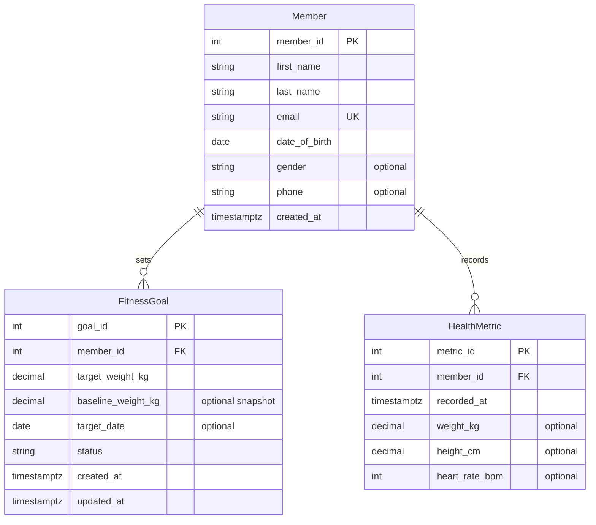

# Member 1: ER-to-relational contribution

This is a partial model for integration into the team's complete `docs/ERD.pdf`.

| Relation / ORM class | Primary key | Foreign key | Additional keys / constraints |
|---|---|---|---|
| `members` / `Member` | `member_id` INTEGER | None | `email` unique, canonical lowercase, valid basic format; nonempty names; DOB not future |
| `fitness_goals` / `FitnessGoal` | `goal_id` INTEGER | `member_id` -> `members.member_id`, NOT NULL, ON DELETE RESTRICT | Target and optional baseline weights positive and <=500; status enumerated by CHECK; optional date >= creation date |
| `health_metrics` / `HealthMetric` | `metric_id` INTEGER | `member_id` -> `members.member_id`, NOT NULL, ON DELETE RESTRICT | At least one measurement; weight/height/heart-rate bounds; timestamp NOT NULL |

Each ER entity maps to one table. Integer primary keys are generated by PostgreSQL.
The two 1:N relationships map to non-null foreign keys on the N side. Member
participation is partial (0..N children); FitnessGoal and HealthMetric participation
is total (exactly one Member each). No associative relation is needed for these
relationships. SQLAlchemy `relationship(back_populates=...)` supplies bidirectional
navigation; foreign keys enforce integrity independently of ORM navigation.

Required fields are NOT NULL. Optional fields are gender/phone, baseline weight,
target date, and individual health values; the measurement CHECK prevents an
entirely empty observation. All timestamp defaults are database-side; the member
service sends validated UTC observation timestamps explicitly.

`member_dashboard` is a derived, non-materialized view, not a fourth base entity.
It uses LATERAL latest-row lookups and a correlated active-goal count, avoiding row
multiplication when a member has multiple goals and measurements. It returns one
row per member. Latest-weight and latest-observation timestamps remain separate.

`ix_health_metrics_member_latest` supports member/time/ID ordering, and
`ix_fitness_goals_member_status` supports active-goal lookup. They are defined in
the ORM and created by `create_all()`, not duplicated in `sql/indexes.sql`.

Other modules should reference `ForeignKey("members.member_id")`. Member 2 already
uses this contract in `feature/trainers`. Its PTSession relationship can be added
by its owner after integration; no speculative relationship names are registered
here. The complete team model must add all selected trainer/admin/class entities
and relationships; the assignment's team-of-three minimum is 10 of each.

## Attendance extension (23 November 2026)

The Member 1 scope now also includes GroupClass and ClassAttendance to supply a
working default past-class count. See `member1_attendance.md` for all attributes,
keys, cardinality and constraints; the updated Member1_ERD.pdf includes both.
The original three relations and member_dashboard SQL view are unchanged.
Attendance is read separately through ORM, so multiple goals/metrics cannot
multiply its count.
